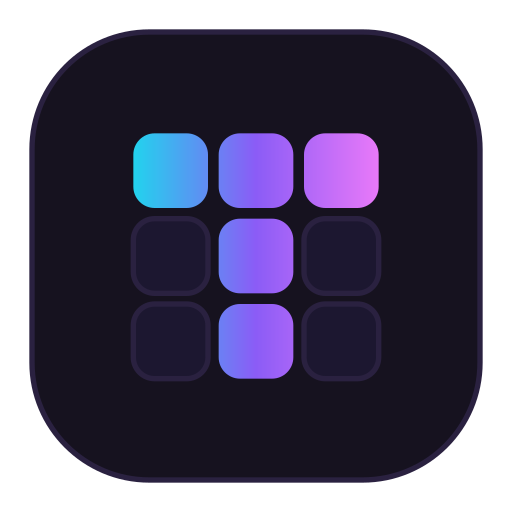

  

<h1 align="center">Tablyne</h1>

<strong>The fast, native DynamoDB GUI.</strong> 
Cross-platform • built in Rust • workspace for every table, account &amp; region.

  <a href="https://tablyne.com">Website</a> ·
  <a href="https://tablyne.com/download/">Download</a> ·
  <a href="https://tablyne.com/pricing/">Pricing</a> ·
  <a href="https://tablyne.com/changelog/">Changelog</a> ·
  <a href="mailto:support@tablyne.com">Support</a>

---

## 👋 This is the Tablyne community tracker

Tablyne itself is closed-source — **this repo is the public home for bugs, feature requests, the roadmap, and release notes.** Tablyne is a desktop app for AWS DynamoDB: a multi-account/region workspace, a spreadsheet-style editable grid with safe bulk edits (dry-run + rollback), a query IDE, Single-Table Design tooling, and local-first connections.

## 🐞 Found a bug? 💡 Have an idea?

[**→ Open an issue**](https://github.com/tablyne/feedback/issues/new/choose)

- **Bug report** — something broken or unexpected (please include your OS + Tablyne version).
- **Feature request** — tell us the problem you're trying to solve.
- Search [existing issues](https://github.com/tablyne/feedback/issues) first — and 👍 the ones you care about, it helps us prioritize.

> ⚠️ **Never paste secrets** — AWS keys, tokens, or real table data. Mask anything sensitive.

For **account, billing, or private** matters, email **[support@tablyne.com](mailto:support@tablyne.com)** instead (your Paddle receipt has billing/invoice links).

## 🗺️ Roadmap &amp; releases

- **Roadmap:** the [issues](https://github.com/tablyne/feedback/issues?q=is%3Aissue+label%3Aroadmap) labeled `roadmap`, ranked by 👍.
- **Releases:** every version ships here under [Releases](https://github.com/tablyne/feedback/releases) and on the [changelog](https://tablyne.com/changelog/).

## 📦 Get Tablyne

Download for **macOS, Windows, and Linux** at **[tablyne.com/download](https://tablyne.com/download/)** — free 14-day trial, no credit card. Plans: Lifetime, Pro, and Team. See [pricing](https://tablyne.com/pricing/).

---

© Tablyne · <a href="https://tablyne.com/privacy/">Privacy</a> · <a href="https://tablyne.com/terms/">Terms</a>

